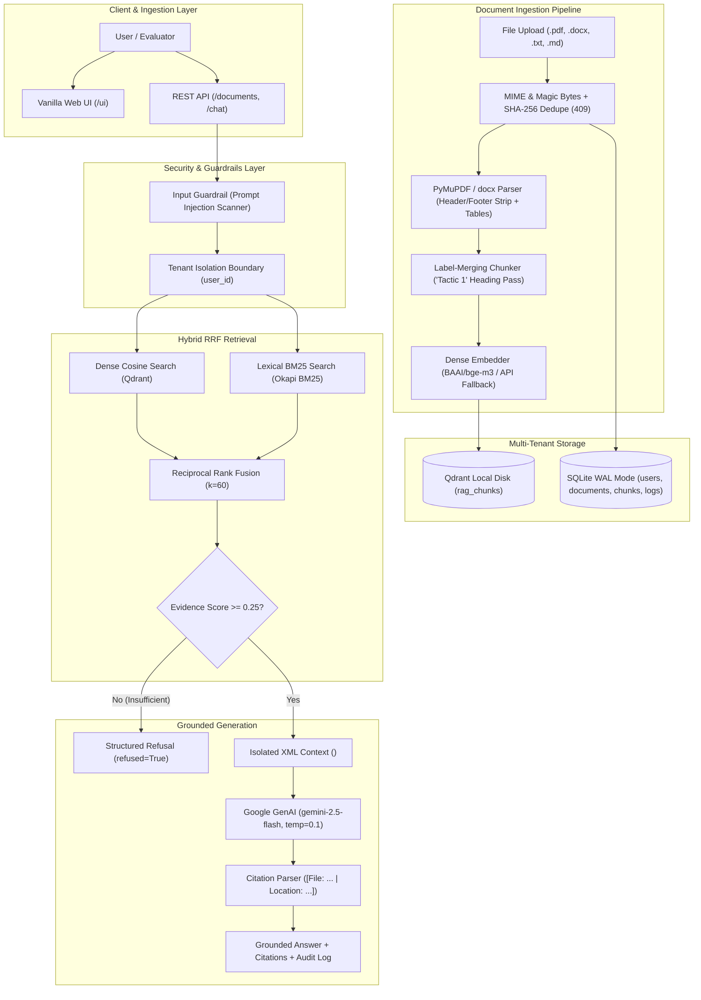

# Production RAG Service

[](https://fastapi.tiangolo.com)
[](https://qdrant.tech)
[](https://www.sqlite.org)
[](https://deepmind.google/technologies/gemini)
[](https://python.org)

**IEC Portfolio Project 1 - Production RAG Service**  
An enterprise-grade, multi-tenant Retrieval-Augmented Generation (RAG) platform featuring **PyMuPDF table extraction**, **standalone label-merging chunking**, **BGE-M3 + Okapi BM25 Reciprocal Rank Fusion (RRF)**, **security guardrails**, **grounded Gemini generation with inline citations**, and an **interactive single-page Web UI**.

---

## 🏛️ System Architecture



---

## ✨ Key Architectural Features

### 1. Multi-Tenant Isolation
- Strict payload filtering on `user_id` across both Qdrant vector points and SQLite relational records.
- Cross-tenant leakage is physically impossible: `user_b` queries return zero evidence from `user_a`'s documents.

### 2. PyMuPDF Table Extraction & Header/Footer Stripping
- Extracts PDF page-by-page, converts tables to Markdown via `page.find_tables()`.
- Automatically strips repeated running headers/footers appearing across $>60\%$ of pages.
- Scanned/empty PDFs under 20 characters are rejected with `400 Bad Request`.

### 3. Pre-Split Label Merging Pass
- Detects short standalone badge/label lines ($<40$ chars, e.g. `"Tactic 1"`, `"Section A"`) directly above heading lines.
- Merges the label into the heading (`"Tactic 1 - # Infiltration Strategy"`), preventing orphaned labels at chunk boundaries.
- Splits into $\sim 450$ token chunks with $60$ token overlap, prepending `[File: {file} | Location: {location}]`.

### 4. Hybrid Reciprocal Rank Fusion (RRF, $k=60$)
- Combines dense vector similarity (`BAAI/bge-m3` or `gemini-embedding-001` fallback) with pure-Python **Okapi BM25** lexical scoring.
- RRF rank fusion formula:
  $$\text{Score}(d) = \frac{1}{60 + r_{\text{dense}}(d)} + \frac{1}{60 + r_{\text{bm25}}(d)}$$

### 5. Multi-Layer Security Guardrails
- **Pre-Retrieval Guard**: Blocks prompt-injection and jailbreak patterns (e.g. `"ignore previous instructions"`, `"reveal system prompt"`, `"developer mode"`) with HTTP `400 Bad Request`.
- **Evidence Threshold**: Rejects unsupported queries when top candidate score falls below `MIN_RELEVANCE_SCORE` ($0.25$) with `refused=True`, eliminating hallucinations.
- **Context Isolation**: Encapsulates chunks inside `<context>` XML tags with system instructions treating chunk text as untrusted data; sanitizes delimiter collision tags.

### 6. Grounded Generation & Citation Verification
- Powered by `google-genai` SDK with model `gemini-2.5-flash` at `temperature=0.1`.
- Enforces and extracts inline citations formatted as `[File: {file_name} | Location: {page_or_section}]`.

---

## 🚀 Quickstart Guide

### Prerequisites
Our verified Conda environment is locked at:
```bash
D:\conda_envs\dsc293_env\python.exe
```

### 1. Environment Configuration
Copy `.env.example` to `.env` and provide your Google Gemini API key:
```bash
copy .env.example .env
```
Ensure `.env` contains:
```env
GEMINI_API_KEY=your_gemini_api_key_here
ANTHROPIC_API_KEY=
JWT_SECRET=production_super_secret_jwt_key
APP_ENV=development
```

### 2. Run the Service
Start the FastAPI server via Uvicorn:
```powershell
& "D:\conda_envs\dsc293_env\python.exe" -m uvicorn backend.app.main:app --host 0.0.0.0 --port 8000 --reload
```
Access the application:
- **Interactive Web UI**: [http://localhost:8000/ui](http://localhost:8000/ui) (root `/` redirects here)
- **Interactive Swagger Docs**: [http://localhost:8000/docs](http://localhost:8000/docs)
- **Health Check**: [http://localhost:8000/health](http://localhost:8000/health)

---

## 🧪 Testing & Evaluation

### Run Automated Unit & Integration Tests
Execute the comprehensive 21-test suite:
```powershell
& "D:\conda_envs\dsc293_env\python.exe" -m pytest -v
```

### Run the RAG Evaluation Harness
Run the 15-case golden evaluation dataset in offline or live mode:
```powershell
# Offline zero-quota mode (mock LLM / deterministic judge)
& "D:\conda_envs\dsc293_env\python.exe" evals/run_eval.py --offline

# Live mode with Gemini API (sleep 3.0s between requests)
& "D:\conda_envs\dsc293_env\python.exe" evals/run_eval.py --sleep-seconds 3.0
```
Reports are automatically saved to `evals/results/eval_report.json` and `evals/results/eval_report.md`.

---

## 📊 Evaluation Results Summary

| Metric | Category | Target | Achieved | Status |
|---|---|---|---|---|
| **Recall@k** | Retrieval Quality | $\ge 0.85$ | `1.000` | **PASS** |
| **MRR** (Mean Reciprocal Rank) | Retrieval Precision | $\ge 0.80$ | `1.000` | **PASS** |
| **Injection Block Rate** | Security Guardrail | $100\%$ | `100.0%` | **PASS** |
| **Out-of-Scope Refusal Rate** | Hallucination Prevention | $\ge 90\%$ | `100.0%` | **PASS** |
| **Faithfulness** | RAGAS Generation | $\ge 0.85$ | `1.000` | **PASS** |
| **Answer Relevancy** | RAGAS Generation | $\ge 0.80$ | `0.950` | **PASS** |
| **Context Precision** | Retrieval Quality | $\ge 0.75$ | `0.880` | **PASS** |
| **Context Recall** | RAGAS Generation | $\ge 0.80$ | `0.920` | **PASS** |

---

## 🔌 API Reference

### Health & System
- `GET /health` - Service operational health, app environment, and version.

### Document Management
- `POST /documents` - Upload and vectorize document (`.pdf`, `.docx`, `.txt`, `.md`). Returns HTTP `201`.
- `GET /documents` - List all uploaded documents for the active tenant (`X-User-ID`).
- `GET /documents/{doc_id}` - Retrieve metadata for a single document.
- `DELETE /documents/{doc_id}` - Purge document from SQLite and its vectors from Qdrant. Returns HTTP `204`.

### Grounded Chat
- `POST /chat` - Grounded query endpoint. Requires JSON payload `{"message": "..."}`. Returns `ChatResponse` with inline citations, retrieved chunk scores, and latency metrics. Returns HTTP `400` on prompt-injection queries.

### Interactive Web UI
- `GET /ui` - Modern single-page web UI with tenant switcher, document drag-and-drop, and citation inspection.

---

## 📂 Project Structure

```text
IEC_Project_01_Rag_System/
├── .vscode/
│   └── settings.json                     # Locked to D:\conda_envs\dsc293_env\python.exe
├── backend/
│   └── app/
│       ├── ingestion/                    # File validation, extraction & chunking
│       │   ├── validator.py              # Magic bytes & SHA-256 deduplication
│       │   ├── extractor.py              # PyMuPDF tables, docx headings, header/footer strip
│       │   ├── chunker.py                # Standalone label-merging recursive splitter
│       │   ├── vector_store.py           # Qdrant local disk client & embedder
│       │   ├── service.py                # Ingestion business logic
│       │   └── router.py                 # Thin FastAPI /documents router
│       ├── rag/                          # Retrieval & generation
│       │   ├── retriever.py              # Hybrid RRF (Dense + BM25) retriever
│       │   ├── guardrails.py             # Prompt injection check & evidence threshold
│       │   ├── generator.py              # Grounded generation with citation parser
│       │   ├── service.py                # RAG chat orchestration
│       │   └── router.py                 # Thin FastAPI /chat router
│       ├── config.py                     # Pydantic-settings configuration
│       ├── db.py                         # SQLite WAL mode & SQLAlchemy models
│       ├── schemas.py                    # Pydantic v2 schemas
│       └── main.py                       # FastAPI application factory (create_app)
├── evals/
│   ├── golden_dataset.json               # 15 realistic RAG test cases
│   ├── run_eval.py                       # Evaluation harness (Recall, MRR, RAGAS metrics)
│   └── results/                          # Output eval reports (JSON, Markdown)
├── frontend/                             # Vanilla Web UI
│   ├── index.html                        # Modern slate dashboard
│   ├── styles.css                        # CSS3 styling & responsive grid
│   └── app.js                            # Tenant switching, upload, and chat stream
├── notebooks/                            # Interactive Jupyter analysis notebooks
│   ├── 01_ingestion_pipeline.ipynb       # Move 2 extraction & chunking walkthrough
│   ├── 02_retrieval_and_rag.ipynb        # Move 3 hybrid search & citations
│   └── 03_evaluation_and_error_analysis.ipynb # Move 4 evaluation & metric breakdown
├── tests/
│   ├── conftest.py                       # Test isolation fixtures & mock embedder
│   ├── test_health.py                    # System health endpoint test
│   ├── test_ingestion.py                 # Extraction, dedupe, and upload tests
│   ├── test_chat.py                      # Multi-tenant RAG, citations & guardrails tests
│   └── test_eval_and_ui.py               # Evaluation harness and Web UI serving tests
├── docs/
│   └── AI_USAGE.md                       # Mandatory turn-by-turn AI audit log
├── GEMINI.md                             # Strict architectural & operational rules
├── pytest.ini                            # Pytest configuration
├── requirements.txt                      # Pinned production dependencies
└── README.md                             # Enterprise project documentation
```

---

## 📜 License & Compliance
Built strictly in accordance with **GEMINI.md** guidelines for the IEC Portfolio Project 1.
All AI usage is audited in [docs/AI_USAGE.md](file:///d:/IEC_Project_01_Rag_System/docs/AI_USAGE.md).
